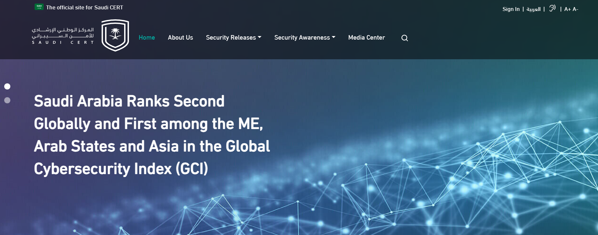
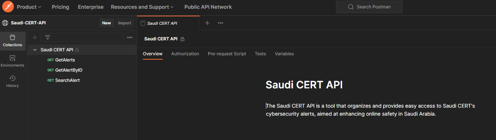
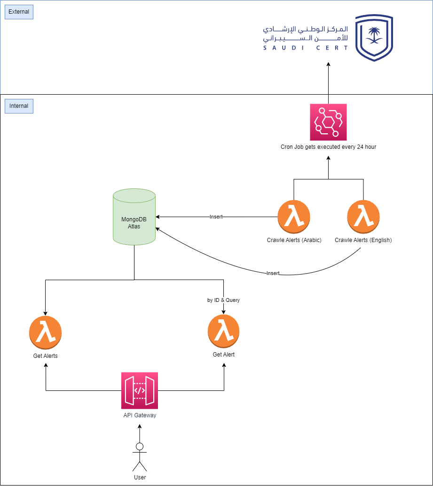

# Saudi Cert Lambda (Parser & Public API) 🚀




## Revised Goal

This repository features a specialized tool and API for Saudi CERT alerts, focusing on bolstering online safety in Saudi Arabia. Utilizing AWS Lambda, it efficiently gathers and organizes Saudi CERT's alerts, providing easy access through a public API.

In its pursuit, the project prioritizes offering the latest data on emerging cybersecurity threats. This approach ensures individuals and organizations are well-informed and prepared to tackle modern digital security challenges.

## Status


## Tech Used


## Documentation in Postamn

You can find the api documentation, and also you can test the api endpoints from here 🚀

`https://www.postman.com/anqahtani/workspace/saudi-cert-api/collection/30891854-1352c7be-f75f-4677-907e-faf39d50f8cb?action=share&creator=30891854`



## Overview 📖


This repository has a tool and an API for Saudi CERT alerts. Its goal is to help improve online safety knowledge in Saudi Arabia. Using AWS Lambda, this project takes Saudi CERT's alerts, organizes them, and makes them easy to get through a public API.

These AWS Lambda function are designed to retrieve security alerts from a MongoDB database. It supports querying alerts by various attributes such as ID, title, severity, and more.

## Features ✨
- Fetch alerts by ID or other specified attributes.
- Serverless approach leveraging AWS Lambda.
- Integration with MongoDB.
- Supported Arabic & English languages

## Deployment Status ✅
The Lambda function has been successfully deployed and is operational.

## Setup 🔧
- Ensure MongoDB is set up with your alerts data.
- Deploy the Lambda function with the necessary environment variables (e.g., `MONGO_URI`).
- Configure Lambda to interact with your MongoDB instance.

## Usage 💡
Invoke the function via AWS SDK or an API Gateway endpoint with appropriate query parameters to retrieve alerts.


## System Diagram

### Download alerts

Add `format=json`, `format=csv` or `format=xlsx` to `get_alerts` to download
the requested page. The existing `page`, `limit` and `lang` parameters apply;
the default is page 1 with 10 English alerts. Without `format`, the existing
JSON response with pagination metadata is unchanged.

For example: `get_alerts?format=xlsx&lang=ar&page=1&limit=100`.
CSV and Excel flatten nested fields into columns such as
`details.warning_number`. CSV includes a UTF-8 BOM for Arabic text in Excel.
Spreadsheet values are exported as text to prevent formula execution.

Package `functions/alerts/requirements.txt` dependencies with the alerts Lambda.
For Excel downloads, configure the API Gateway REST API binary media types to
include `*/*` so it decodes the Lambda's base64 response for browser downloads.
The usual Lambda and API Gateway response size limits apply; use pagination
for large datasets. No deployment automation is included in this repository.

Run the tests with `python -m unittest discover -s tests -v` after installing
the alerts requirements.



## Testing

You can test endpoints by using the following http.http file 😉

```http
###
# Get Alerts - Fetch multiple alerts with optional query parameters
# Basic usage without query parameters
GET https://1tozt5y6hl.execute-api.us-east-1.amazonaws.com/default/get_alerts

# Usage with query parameters
GET https://1tozt5y6hl.execute-api.us-east-1.amazonaws.com/default/get_alerts?page=1&limit=5

# Fetching alerts based on specific attributes like title or severity
GET https://1tozt5y6hl.execute-api.us-east-1.amazonaws.com/default/get_alerts?title=Weekly%20Vulnerability&severity=Critical

###
# Get Alert - Fetch a single alert by its ID
# Replace <ALERT_ID> with the actual ID of the alert
GET https://sas5g5ymqb.execute-api.us-east-1.amazonaws.com/default/get_alert?alert_id=<ALERT_ID>

# Example with a placeholder ID
GET https://sas5g5ymqb.execute-api.us-east-1.amazonaws.com/default/get_alert?alert_id=5f50c31e8eabf80018e4b255
```

Also you can test through curl 😉

```sh
# Fetching Multiple Alerts Without Query Parameters
$ curl "https://1tozt5y6hl.execute-api.us-east-1.amazonaws.com/default/get_alerts"

# Fetching Multiple Alerts With Query Parameters
$ curl "https://1tozt5y6hl.execute-api.us-east-1.amazonaws.com/default/get_alerts?page=1&limit=5"

# Fetching Alerts Based on Specific Attributes
$ curl "https://sas5g5ymqb.execute-api.us-east-1.amazonaws.com/default/get_alert?title=Weekly%20Vulnerability&severity=Critical"

# Fetching a Single Alert by ID For this, you need to replace <ALERT_ID> with the actual ID of the alert.
$ curl "https://sas5g5ymqb.execute-api.us-east-1.amazonaws.com/default/get_alert?id=6554e21e7573c0e94fb0db30"
```


## Endpoints

| Description | Method | URL | Notes |
|-------------|--------|-----|---------------|
| **Get Alerts** <br> Fetch multiple alerts | `GET` | `https://1tozt5y6hl.execute-api.us-east-1.amazonaws.com/default/get_alerts` | Basic usage without query parameters |
| **Get Alerts with Parameters** <br> Fetch alerts with pagination | `GET` | `https://1tozt5y6hl.execute-api.us-east-1.amazonaws.com/default/get_alerts?page=1&limit=5` | Fetches alerts with page 1 and limit 5 |
| **Get Alerts by Attributes** <br> Fetch alerts based on title or severity | `GET` | `https://1tozt5y6hl.execute-api.us-east-1.amazonaws.com/default/get_alerts?title=Weekly%20Vulnerability&severity=Critical` | Fetches alerts with specific title and severity |
| **Get Alert by ID** <br> Fetch a single alert | `GET` | `https://sas5g5ymqb.execute-api.us-east-1.amazonaws.com/default/get_alert?alert_id=<ALERT_ID>` | Replace `<ALERT_ID>` with the actual ID |
| **Example Get Alert** <br> Example with a placeholder ID | `GET` | `https://sas5g5ymqb.execute-api.us-east-1.amazonaws.com/default/get_alert?alert_id=5f50c31e8eabf80018e4b255` | Example using a specific alert ID |


## Responses

### Get Alert (ID) ⚠️

`https://sas5g5ymqb.execute-api.us-east-1.amazonaws.com/default/get_alert?id=65536f5d500c2238622268d8`

```json
{
  "alert": {
    "_id": {
      "$oid": "65536f5d500c2238622268d8"
    },
    "title": "Weekly Vulnerabilitie…",
    "severity": "Critical",
    "logo": "https://cert.gov.sa/media/non_XcxHHds.jpg",
    "alert_url": "https://cert.gov.sa/en/security-warnings/weekly-vulnerabilities-summary-29-october-4-november/",
    "details": {
      "warning_date": "12 November, 2023",
      "severity_level": "● Critical",
      "warning_number": "2023-5891",
      "target_sector": "All",
      "p_1": "Warning Date",
      "p_2": "Severity Level",
      "p_3": "Warning Number",
      "p_4": "Target Sector",
      "p_5": "12 November, 2023",
      "p_6": "● Critical",
      "p_7": "2023-5891",
      "p_8": "All",
      "link_9": "/documents/137/Weekly_Vulnerabilities_Summary_29_October_4_November.pdf",
      "p_10": "Description:",
      "p_11": "We provide the weekly summary of published vulnerabilities by the National Institute of Standards and Technology (NIST) National Vulnerability Database (NVD) for the week from 29th of October to 4th of November. Vulnerabilities are scored using the Common Vulnerability Scoring System (CVSS) standard as per the following severity:",
      "i_1": "Critical:      CVSS base score of 9.0-10.0",
      "i_2": "High:      CVSS base score of 7.0-8.9",
      "i_3": "Medium:      CVSS base score 4.0-6.9",
      "i_4": "Low:      CVSS base score 0.0-3.9",
      "link_12": "/documents/137/Weekly_Vulnerabilities_Summary_29_October_4_November.pdf",
      "p_13": "We provide the vulnerability information as published by NIST’s NVD. In addition, it is the entity’s or individual’s responsibility to ensure the implementation of appropriate recommendations."
    }
  }
}
```

`https://sas5g5ymqb.execute-api.us-east-1.amazonaws.com/default/get_alert?id=6555366754572009bcd38905&lang=ar`

```json
{
    "alert": {
        "_id": {
            "$oid": "6555366754572009bcd38905"
        },
        "title": "تنبيه Adobe",
        "severity": "عالٍ جدًا",
        "logo": "https://cert.gov.sa/media/Adobe_rG1RtZq.png",
        "alert_url": "https://cert.gov.sa/ar/security-warnings/adobe-alert1114/",
        "details": {
            "warning_date": "14 نوفمبر, 2023",
            "severity_level": "● عالٍ جدًا",
            "warning_number": "2023-5898",
            "target_sector": "الكل",
            "p_1": "تاريخ التحذير",
            "p_2": "مستوى الخطورة",
            "p_3": "رقم التحذير",
            "p_4": "القطاع المستهدف",
            "p_5": "14 نوفمبر, 2023",
            "p_6": "● عالٍ جدًا",
            "p_7": "2023-5898",
            "p_8": "الكل",
            "link_9": "https://helpx.adobe.com/security/products/coldfusion/apsb23-52.html",
            "p_10": "",
            "p_11": "الوصف:",
            "p_12": "أصدرت Adobe  عدّة تحديثات لمعالجة عدد من الثغرات في منتجاتها.",
            "p_13": "الاجراءات الوقائية:",
            "p_14": "يوصي المركز بتحديث النسخ المتأثرة حيث أصدرت Adobe توضيحًا لهذه التحديثات:",
            "i_1": "·https://helpx.adobe.com/security/products/coldfusion/apsb23-52.html",
            "i_2": "·https://helpx.adobe.com/security/products/robohelp-server/apsb23-53.html",
            "i_3": "·https://helpx.adobe.com/security/products/acrobat/apsb23-54.html",
            "i_4": "·https://helpx.adobe.com/security/products/photoshop/apsb23-56.html",
            "i_5": "·https://helpx.adobe.com/security/products/framemaker/apsb23-58.html",
            "i_6": "·https://helpx.adobe.com/security/products/incopy/apsb23-60.html",
            "i_7": "·https://helpx.adobe.com/security/products/media-encoder/apsb23-63.html",
            "i_8": "·https://helpx.adobe.com/security/products/audition/apsb23-64.html",
            "i_9": "·https://helpx.adobe.com/security/products/premiere_pro/apsb23-65.html",
            "i_10": "·https://helpx.adobe.com/security/products/after_effects/apsb23-66.html"
        }
    }
}
```

### Get Alert (Query Parameters) ⚠️

`https://sas5g5ymqb.execute-api.us-east-1.amazonaws.com/default/get_alert?title=Google%20Chrome%20Alert`

```json
{
 {
    "status": "success",
    "message": "Alerts retrieved successfully",
    "total_alerts": 62,
    "alerts": [
        {
            "_id": {
                "$oid": "6554e21d7573c0e94fb0db2c"
            },
            "title": "Weekly Vulnerabilitie…",
            "severity": "Critical",
            "logo": "https://cert.gov.sa/media/non_XcxHHds.jpg",
            "alert_url": "https://cert.gov.sa/en/security-warnings/weekly-vulnerabilities-summary-29-october-4-november/",
            "details": {
                "warning_date": "12 November, 2023",
                "severity_level": "● Critical",
                "warning_number": "2023-5891",
                "target_sector": "All",
                "p_1": "Warning Date",
                "p_2": "Severity Level",
                "p_3": "Warning Number",
                "p_4": "Target Sector",
                "p_5": "12 November, 2023",
                "p_6": "● Critical",
                "p_7": "2023-5891",
                "p_8": "All",
                "link_9": "/documents/137/Weekly_Vulnerabilities_Summary_29_October_4_November.pdf",
                "p_10": "Description:",
                "p_11": "We provide the weekly summary of published vulnerabilities by the National Institute of Standards and Technology (NIST) National Vulnerability Database (NVD) for the week from 29th of October to 4th of November. Vulnerabilities are scored using the Common Vulnerability Scoring System (CVSS) standard as per the following severity:",
                "i_1": "Critical:      CVSS base score of 9.0-10.0",
                "i_2": "High:      CVSS base score of 7.0-8.9",
                "i_3": "Medium:      CVSS base score 4.0-6.9",
                "i_4": "Low:      CVSS base score 0.0-3.9",
                "link_12": "/documents/137/Weekly_Vulnerabilities_Summary_29_October_4_November.pdf",
                "p_13": "We provide the vulnerability information as published by NIST’s NVD. In addition, it is the entity’s or individual’s responsibility to ensure the implementation of appropriate recommendations."
            }
        },
        {
            "_id": {
                "$oid": "6554e21d7573c0e94fb0db2d"
            },
            "title": "Foxit Alert",
            "severity": "High",
            "logo": "https://cert.gov.sa/media/FOX_IT_cAD4gnL.png",
            "alert_url": "https://cert.gov.sa/en/security-warnings/foxit-alert1111/",
            "details": {
                "warning_date": "11 November, 2023",
                "severity_level": "● High",
                "warning_number": "2023-5890",
                "target_sector": "All",
                "p_1": "Warning Date",
                "p_2": "Severity Level",
                "p_3": "Warning Number",
                "p_4": "Target Sector",
                "p_5": "11 November, 2023",
                "p_6": "● High",
                "p_7": "2023-5890",
                "p_8": "All",
                "link_9": "https://www.foxit.com/support/security-bulletins.html",
                "p_10": "",
                "p_11": "Description:",
                "p_12": "Foxit has released a security update to address a vulnerability in their products.",
                "p_13": "Best practice and Recommendations:",
                "p_14": "The CERT team encourages users to review Foxit security advisory and update the affected products:",
                "i_1": "https://www.foxit.com/support/security-bulletins.html"
            }
        },
        {
            "_id": {
                "$oid": "6554e21e7573c0e94fb0db2e"
            },
            "title": "NETGEAR Alert",
            "severity": "High",
            "logo": "https://cert.gov.sa/media/NETGEAR_dMW0amc.png",
            "alert_url": "https://cert.gov.sa/en/security-warnings/netgear-alert-2023-11-11/",
            "details": {
                "warning_date": "11 November, 2023",
                "severity_level": "● High",
                "warning_number": "2023-5889",
                "target_sector": "All",
                "p_1": "Warning Date",
                "p_2": "Severity Level",
                "p_3": "Warning Number",
                "p_4": "Target Sector",
                "p_5": "11 November, 2023",
                "p_6": "● High",
                "p_7": "2023-5889",
                "p_8": "All",
                "strong_9": "Description:",
                "p_10": "NETGEAR has released a security update to address several vulnerabilities in their products.",
                "strong_11": "Best practice and Recommendations:",
                "p_12": "The CERT team encourages users to review NETGEAR security advisory and apply the necessary updates:",
                "i_1": "https://kb.netgear.com/000065866/Security-Advisory-for-Multiple-Vulnerabilities-on-the-NMS300-PSV-2023-0114-PSV-2023-0115?article=000065866"
            }
        },
        {
            "_id": {
                "$oid": "6554e21e7573c0e94fb0db2f"
            },
            "title": "Atlassian Alert",
            "severity": "Critical",
            "logo": "https://cert.gov.sa/media/atlassian_63546K5.png",
            "alert_url": "https://cert.gov.sa/en/security-warnings/atlassian-alert-2023-11-10/",
            "details": {
                "warning_date": "10 November, 2023",
                "severity_level": "● Critical",
                "warning_number": "2023-5888",
                "target_sector": "All",
                "p_1": "Warning Date",
                "p_2": "Severity Level",
                "p_3": "Warning Number",
                "p_4": "Target Sector",
                "p_5": "10 November, 2023",
                "p_6": "● Critical",
                "p_7": "2023-5888",
                "p_8": "All",
                "strong_9": "Description:",
                "p_10": "Atlassian has released security updates to address a vulnerability in their products.",
                "strong_11": "Best practice and Recommendations:",
                "p_12": "The CERT team encourages users to review Atlassian security advisory and apply the necessary updates:",
                "i_1": "https://confluence.atlassian.com/security/cve-2023-46604-apache-activemq-rce-vulnerability-impacts-bamboo-data-center-and-server-1319242919.html?permissionViolation=true"
            }
        },
        {
            "_id": {
                "$oid": "6554e21e7573c0e94fb0db30"
            },
            "title": "Google Chrome Alert",
            "severity": "High",
            "logo": "https://cert.gov.sa/media/Chrome_BwTZEoM.png",
            "alert_url": "https://cert.gov.sa/en/security-warnings/google-chrome-alert119/",
            "details": {
                "warning_date": "9 November, 2023",
                "severity_level": "● High",
                "warning_number": "2023-5887",
                "target_sector": "All",
                "p_1": "Warning Date",
                "p_2": "Severity Level",
                "p_3": "Warning Number",
                "p_4": "Target Sector",
                "p_5": "9 November, 2023",
                "p_6": "● High",
                "p_7": "2023-5887",
                "p_8": "All",
                "link_9": "https://chromereleases.googleblog.com/2023/11/chrome-for-android-update.html",
                "p_10": "",
                "p_11": "Description:",
                "p_12": "Google has released a security update to address several vulnerabilities in Chrome browser for Android .",
                "p_13": "Best practice and Recommendations:",
                "p_14": "The CERT team encourages users to update the affected product, For more information, please follow the below link:",
                "i_1": "https://chromereleases.googleblog.com/2023/11/chrome-for-android-update.html"
            }
        },
        {
            "_id": {
                "$oid": "6554e21e7573c0e94fb0db31"
            },
            "title": "Google Chrome Alert",
            "severity": "High",
            "logo": "https://cert.gov.sa/media/Chrome_fNmvIxD.png",
            "alert_url": "https://cert.gov.sa/en/security-warnings/google-chrome-alert118/",
            "details": {
                "warning_date": "8 November, 2023",
                "severity_level": "● High",
                "warning_number": "2023-5886",
                "target_sector": "All",
                "p_1": "Warning Date",
                "p_2": "Severity Level",
                "p_3": "Warning Number",
                "p_4": "Target Sector",
                "p_5": "8 November, 2023",
                "p_6": "● High",
                "p_7": "2023-5886",
                "p_8": "All",
                "link_9": "https://chromereleases.googleblog.com/2023/11/stable-channel-update-for-desktop.html",
                "p_10": "",
                "p_11": "Description:",
                "p_12": "Google has released security updates to address several vulnerabilities in Chrome browser and ChromeOS.",
                "p_13": "Best practice and Recommendations:",
                "p_14": "The CERT team encourages users to update the affected products, For more information, please follow the below links:",
                "i_1": "https://chromereleases.googleblog.com/2023/11/stable-channel-update-for-desktop.html",
                "i_2": "https://chromereleases.googleblog.com/2023/11/long-term-support-channel-update-for.html"
            }
        },
        {
            "_id": {
                "$oid": "6554e2577573c0e94fb0db34"
            },
            "title": "Google Chrome Alert",
            "severity": "High",
            "logo": "https://cert.gov.sa/media/Chrome_oF8imzn.png",
            "alert_url": "https://cert.gov.sa/en/security-warnings/google-chrome-alert-2023-11-15/",
            "details": {
                "warning_date": "15 November, 2023",
                "severity_level": "● High",
                "warning_number": "2023-5901",
                "target_sector": "All",
                "p_1": "Warning Date",
                "p_2": "Severity Level",
                "p_3": "Warning Number",
                "p_4": "Target Sector",
                "p_5": "15 November, 2023",
                "p_6": "● High",
                "p_7": "2023-5901",
                "p_8": "All",
                "strong_9": "Description:",
                "p_10": "Google has released a security update to address several vulnerabilities in Chrome products.",
                "strong_11": "Best practice and Recommendations:",
                "p_12": "The CERT team encourages users to update the affected products, For more information, please follow the below links:",
                "i_1": "https://chromereleases.googleblog.com/2023/11/stable-channel-update-for-desktop_14.html",
                "i_2": "https://chromereleases.googleblog.com/2023/11/stable-channel-update-for.html"
            }
        },
        {
            "_id": {
                "$oid": "6554e2587573c0e94fb0db35"
            },
            "title": "Aruba Alert",
            "severity": "Critical",
            "logo": "https://cert.gov.sa/media/Aruba-Networks_DLgUEUm.png",
            "alert_url": "https://cert.gov.sa/en/security-warnings/aruba-alert-2023-11-15/",
            "details": {
                "warning_date": "15 November, 2023",
                "severity_level": "● Critical",
                "warning_number": "2023-5900",
                "target_sector": "All",
                "p_1": "Warning Date",
                "p_2": "Severity Level",
                "p_3": "Warning Number",
                "p_4": "Target Sector",
                "p_5": "15 November, 2023",
                "p_6": "● Critical",
                "p_7": "2023-5900",
                "p_8": "All",
                "strong_9": "Description:",
                "p_10": "Aruba has released security updates to address several vulnerabilities in their products.",
                "strong_11": "Best practice and Recommendations:",
                "p_12": "The CERT team encourages users to review Aruba security advisory and update the affected products:",
                "i_1": "https://www.arubanetworks.com/assets/alert/ARUBA-PSA-2023-017.txt"
            }
        },
        {
            "_id": {
                "$oid": "6554e2587573c0e94fb0db36"
            },
            "title": "VMware Alert",
            "severity": "Critical",
            "logo": "https://cert.gov.sa/media/Vmware_4TPABBJ.jpg",
            "alert_url": "https://cert.gov.sa/en/security-warnings/vmware-alert-2023-11-15/",
            "details": {
                "warning_date": "15 November, 2023",
                "severity_level": "● Critical",
                "warning_number": "2023-5899",
                "target_sector": "All",
                "p_1": "Warning Date",
                "p_2": "Severity Level",
                "p_3": "Warning Number",
                "p_4": "Target Sector",
                "p_5": "15 November, 2023",
                "p_6": "● Critical",
                "p_7": "2023-5899",
                "p_8": "All",
                "strong_9": "Description:",
                "p_10": "VMware has released a security update to address a critical vulnerability in its product.",
                "strong_11": "Best practice and Recommendations:",
                "p_12": "The CERT team encourages users to review VMware security advisory and update the affected product:",
                "i_1": "https://www.vmware.com/security/advisories/VMSA-2023-0026.html"
            }
        },
        {
            "_id": {
                "$oid": "6554e2587573c0e94fb0db37"
            },
            "title": "Adobe Alert",
            "severity": "Critical",
            "logo": "https://cert.gov.sa/media/Adobe_rG1RtZq.png",
            "alert_url": "https://cert.gov.sa/en/security-warnings/adobe-alert1114/",
            "details": {
                "warning_date": "14 November, 2023",
                "severity_level": "● Critical",
                "warning_number": "2023-5898",
                "target_sector": "All",
                "p_1": "Warning Date",
                "p_2": "Severity Level",
                "p_3": "Warning Number",
                "p_4": "Target Sector",
                "p_5": "14 November, 2023",
                "p_6": "● Critical",
                "p_7": "2023-5898",
                "p_8": "All",
                "link_9": "https://helpx.adobe.com/security/products/coldfusion/apsb23-52.html",
                "p_10": "",
                "p_11": "Description:",
                "p_12": "Adobe has released security updates to address several vulnerabilities in their products.",
                "p_13": "Best practice and Recommendations:",
                "p_14": "The CERT team encourages users to review Adobe security advisory and apply the necessary updates:",
                "i_1": "·https://helpx.adobe.com/security/products/coldfusion/apsb23-52.html",
                "i_2": "·https://helpx.adobe.com/security/products/robohelp-server/apsb23-53.html",
                "i_3": "·https://helpx.adobe.com/security/products/acrobat/apsb23-54.html",
                "i_4": "·https://helpx.adobe.com/security/products/photoshop/apsb23-56.html",
                "i_5": "·https://helpx.adobe.com/security/products/framemaker/apsb23-58.html",
                "i_6": "·https://helpx.adobe.com/security/products/incopy/apsb23-60.html",
                "i_7": "·https://helpx.adobe.com/security/products/media-encoder/apsb23-63.html",
                "i_8": "·https://helpx.adobe.com/security/products/audition/apsb23-64.html",
                "i_9": "·https://helpx.adobe.com/security/products/premiere_pro/apsb23-65.html",
                "i_10": "·https://helpx.adobe.com/security/products/after_effects/apsb23-66.html"
            }
        }
    ],
    "next_page": "https://1tozt5y6hl.execute-api.us-east-1.amazonaws.com/default/get_alerts?page=2&limit=10"
}
```

## Supported Arabic Language 

`https://1tozt5y6hl.execute-api.us-east-1.amazonaws.com/default/get_alerts?page=1&limit=10&lang=ar`

```json
{
    "status": "success",
    "message": "Alerts retrieved successfully",
    "total_alerts": 2145,
    "alerts": [
        {
            "_id": {
                "$oid": "6555366754572009bcd38905"
            },
            "title": "تنبيه Adobe",
            "severity": "عالٍ جدًا",
            "logo": "https://cert.gov.sa/media/Adobe_rG1RtZq.png",
            "alert_url": "https://cert.gov.sa/ar/security-warnings/adobe-alert1114/",
            "details": {
                "warning_date": "14 نوفمبر, 2023",
                "severity_level": "● عالٍ جدًا",
                "warning_number": "2023-5898",
                "target_sector": "الكل",
                "p_1": "تاريخ التحذير",
                "p_2": "مستوى الخطورة",
                "p_3": "رقم التحذير",
                "p_4": "القطاع المستهدف",
                "p_5": "14 نوفمبر, 2023",
                "p_6": "● عالٍ جدًا",
                "p_7": "2023-5898",
                "p_8": "الكل",
                "link_9": "https://helpx.adobe.com/security/products/coldfusion/apsb23-52.html",
                "p_10": "",
                "p_11": "الوصف:",
                "p_12": "أصدرت Adobe  عدّة تحديثات لمعالجة عدد من الثغرات في منتجاتها.",
                "p_13": "الاجراءات الوقائية:",
                "p_14": "يوصي المركز بتحديث النسخ المتأثرة حيث أصدرت Adobe توضيحًا لهذه التحديثات:",
                "i_1": "·https://helpx.adobe.com/security/products/coldfusion/apsb23-52.html",
                "i_2": "·https://helpx.adobe.com/security/products/robohelp-server/apsb23-53.html",
                "i_3": "·https://helpx.adobe.com/security/products/acrobat/apsb23-54.html",
                "i_4": "·https://helpx.adobe.com/security/products/photoshop/apsb23-56.html",
                "i_5": "·https://helpx.adobe.com/security/products/framemaker/apsb23-58.html",
                "i_6": "·https://helpx.adobe.com/security/products/incopy/apsb23-60.html",
                "i_7": "·https://helpx.adobe.com/security/products/media-encoder/apsb23-63.html",
                "i_8": "·https://helpx.adobe.com/security/products/audition/apsb23-64.html",
                "i_9": "·https://helpx.adobe.com/security/products/premiere_pro/apsb23-65.html",
                "i_10": "·https://helpx.adobe.com/security/products/after_effects/apsb23-66.html"
            }
        },
        {
            "_id": {
                "$oid": "6555366754572009bcd38906"
            },
            "title": "تنبيه Intel®",
            "severity": "عالٍ جدًا",
            "logo": "https://cert.gov.sa/media/intel_qZA4El6.png",
            "alert_url": "https://cert.gov.sa/ar/security-warnings/intel-alert1114/",
            "details": {
                "warning_date": "14 نوفمبر, 2023",
                "severity_level": "● عالٍ جدًا",
                "warning_number": "2023-5897",
                "target_sector": "الكل",
                "p_1": "تاريخ التحذير",
                "p_2": "مستوى الخطورة",
                "p_3": "رقم التحذير",
                "p_4": "القطاع المستهدف",
                "p_5": "14 نوفمبر, 2023",
                "p_6": "● عالٍ جدًا",
                "p_7": "2023-5897",
                "p_8": "الكل",
                "link_9": "https://www.intel.com/content/www/us/en/security-center/advisory/intel-sa-00719.html",
                "p_10": "",
                "p_11": "الوصف:",
                "p_12": "أصدرت Intel® عدًة تحديثات لمعالجة عددٍ من الثغرات في منتجاتها.",
                "p_13": "الاجراءات الوقائية:",
                "p_14": "يوصي المركز بتحديث المنتجات المتأثرة، حيث أصدرت Intel® توضيحاً لهذه التحديثات عبر الروابط أدناه:",
                "i_1": "https://www.intel.com/content/www/us/en/security-center/advisory/intel-sa-00719.html",
                "i_2": "https://www.intel.com/content/www/us/en/security-center/advisory/intel-sa-00841.html",
                "i_3": "https://www.intel.com/content/www/us/en/security-center/advisory/intel-sa-00861.html",
                "i_4": "https://www.intel.com/content/www/us/en/security-center/advisory/intel-sa-00900.html",
                "i_5": "https://www.intel.com/content/www/us/en/security-center/advisory/intel-sa-00902.html",
                "i_6": "https://www.intel.com/content/www/us/en/security-center/advisory/intel-sa-00908.html",
                "i_7": "https://www.intel.com/content/www/us/en/security-center/advisory/intel-sa-00944.html",
                "i_8": "https://www.intel.com/content/www/us/en/security-center/advisory/intel-sa-00945.html",
                "i_9": "https://www.intel.com/content/www/us/en/security-center/advisory/intel-sa-00950.html",
                "i_10": "https://www.intel.com/content/www/us/en/security-center/advisory/intel-sa-00963.html",
                "i_11": "https://www.intel.com/content/www/us/en/security-center/advisory/intel-sa-00968.html"
            }
        },
        {
            "_id": {
                "$oid": "6555366754572009bcd38907"
            },
            "title": "تنبيه Microsoft",
            "severity": "عالٍ جدًا",
            "logo": "https://cert.gov.sa/media/Microsoft_h3pg4gG.jpg",
            "alert_url": "https://cert.gov.sa/ar/security-warnings/microsoft-alert1114/",
            "details": {
                "warning_date": "14 نوفمبر, 2023",
                "severity_level": "● عالٍ جدًا",
                "warning_number": "2023-5896",
                "target_sector": "الكل",
                "p_1": "تاريخ التحذير",
                "p_2": "مستوى الخطورة",
                "p_3": "رقم التحذير",
                "p_4": "القطاع المستهدف",
                "p_5": "14 نوفمبر, 2023",
                "p_6": "● عالٍ جدًا",
                "p_7": "2023-5896",
                "p_8": "الكل",
                "link_9": "https://msrc.microsoft.com/update-guide/releaseNote/2023-Nov",
                "p_10": "",
                "p_11": "لوصف:",
                "p_12": "أصدرت Microsoft عدّة تحديثات لمعالجة عددٍ من الثغرات في منتجاتها.",
                "p_13": "الاجراءات الوقائية:",
                "p_14": "يوصي المركز بتحديث المنتجات المتأثرة، حيث أصدرت Microsoft توضيحًا لهذه التحديثات:",
                "i_1": "https://msrc.microsoft.com/update-guide/releaseNote/2023-Nov"
            }
        },
        {
            "_id": {
                "$oid": "6555366754572009bcd38908"
            },
            "title": "تنبيه SAP",
            "severity": "عالٍ جدًا",
            "logo": "https://cert.gov.sa/media/SAP_bUJsLvQ.png",
            "alert_url": "https://cert.gov.sa/ar/security-warnings/sap-alert1114/",
            "details": {
                "warning_date": "14 نوفمبر, 2023",
                "severity_level": "● عالٍ جدًا",
                "warning_number": "2023-5895",
                "target_sector": "الكل",
                "p_1": "تاريخ التحذير",
                "p_2": "مستوى الخطورة",
                "p_3": "رقم التحذير",
                "p_4": "القطاع المستهدف",
                "p_5": "14 نوفمبر, 2023",
                "p_6": "● عالٍ جدًا",
                "p_7": "2023-5895",
                "p_8": "الكل",
                "link_9": "https://sap.com/documents/2022/02/fa865ea4-167e-0010-bca6-c68f7e60039b.html/",
                "p_10": "",
                "p_11": "الوصف:",
                "p_12": "أصدرت SAP عدّة تحديثات لمعالجة عددٍ من الثغرات في منتجاتها.",
                "p_13": "الاجراءات الوقائية:",
                "p_14": "يوصي المركز بتحديث المنتجات المتأثرة، حيث أصدرت SAP توضيحًا لهذه التحديثات:",
                "i_1": "https://sap.com/documents/2022/02/fa865ea4-167e-0010-bca6-c68f7e60039b.html/"
            }
        },
        {
            "_id": {
                "$oid": "6555366754572009bcd38909"
            },
            "title": "تنبيه Zoom",
            "severity": "عالي",
            "logo": "https://cert.gov.sa/media/zoom_mBjqsUe.png",
            "alert_url": "https://cert.gov.sa/ar/security-warnings/zoom-alert1114/",
            "details": {
                "warning_date": "14 نوفمبر, 2023",
                "severity_level": "● عالي",
                "warning_number": "2023-5894",
                "target_sector": "الكل",
                "p_1": "تاريخ التحذير",
                "p_2": "مستوى الخطورة",
                "p_3": "رقم التحذير",
                "p_4": "القطاع المستهدف",
                "p_5": "14 نوفمبر, 2023",
                "p_6": "● عالي",
                "p_7": "2023-5894",
                "p_8": "الكل",
                "link_9": "https://explore.zoom.us/en/trust/security/security-bulletin/",
                "p_10": "",
                "p_11": "الوصف:",
                "p_12": "أصدرت Zoom عدّة تحديثات لمعالجة عددٍ من الثغرات في منتجاتها.",
                "p_13": "الاجراءات الوقائية:",
                "p_14": "يوصي المركز بتحديث المنتجات المتأثرة، حيث أصدرت Zoom توضيحًا لهذه التحديثات:",
                "i_1": "https://explore.zoom.us/en/trust/security/security-bulletin/"
            }
        },
        {
            "_id": {
                "$oid": "6555366854572009bcd3890a"
            },
            "title": "Foxitتنبيه",
            "severity": "عالي",
            "logo": "https://cert.gov.sa/media/FOX_IT_Tk8lS6n.png",
            "alert_url": "https://cert.gov.sa/ar/security-warnings/alert-foxit/",
            "details": {
                "warning_date": "14 نوفمبر, 2023",
                "severity_level": "● عالي",
                "warning_number": "2023-5893",
                "target_sector": "الكل",
                "p_1": "تاريخ التحذير",
                "p_2": "مستوى الخطورة",
                "p_3": "رقم التحذير",
                "p_4": "القطاع المستهدف",
                "p_5": "14 نوفمبر, 2023",
                "p_6": "● عالي",
                "p_7": "2023-5893",
                "p_8": "الكل",
                "p_9": "أصدرت Foxit تحديثاً لمعالجة عدّة ثغرات في منتجاتها.الاجراءات الوقائية:يوصي المركز بتحديث المنتجات المتأثرة، حيث أصدرت Foxit توضيحًا لهذه التحديثات:https://www.foxit.com/support/security-bulletins.html",
                "p_10": "",
                "p_11": "أصدرت Foxit تحديثاً لمعالجة عدّة ثغرات في منتجاتها.",
                "p_12": "الاجراءات الوقائية:",
                "p_13": "يوصي المركز بتحديث المنتجات المتأثرة، حيث أصدرت Foxit توضيحًا لهذه التحديثات:",
                "i_1": "https://www.foxit.com/support/security-bulletins.html"
            }
        },
        {
            "_id": {
                "$oid": "6555366854572009bcd3890b"
            },
            "title": "Schneider Electric ...",
            "severity": "عالي",
            "logo": "https://cert.gov.sa/media/Schneider_Electric_3b8xZU4.jpg",
            "alert_url": "https://cert.gov.sa/ar/security-warnings/11-14-2023/",
            "details": {
                "warning_date": "14 نوفمبر, 2023",
                "severity_level": "● عالي",
                "warning_number": "2023-5892",
                "target_sector": "الكل",
                "p_1": "تاريخ التحذير",
                "p_2": "مستوى الخطورة",
                "p_3": "رقم التحذير",
                "p_4": "القطاع المستهدف",
                "p_5": "14 نوفمبر, 2023",
                "p_6": "● عالي",
                "p_7": "2023-5892",
                "p_8": "الكل",
                "p_9": "أصدرت Schneider Electric عدة تحديثات لمعالجة عدد من الثغرات في منتجاتها.الاجراءات الوقائية:يوصي المركز بتحديث النسخ المتأثرة حيث أصدرت Schneider Electric توضيحًا لهذه التحديثات:https://download.schneider-electric.com/files?p_Doc_Ref=SEVD-2023-318-02&p_enDocType=Security+and+Safety+Notice&p_File_Name=SEVD-2023-318-02.pdfhttps://download.schneider-electric.com/files?p_Doc_Ref=SEVD-2023-318-01&p_enDocType=Security+and+Safety+Notice&p_File_Name=SEVD-2023-318-01.pdf",
                "p_10": "",
                "p_11": "",
                "p_12": "أصدرت Schneider Electric عدة تحديثات لمعالجة عدد من الثغرات في منتجاتها.",
                "p_13": "الاجراءات الوقائية:",
                "p_14": "يوصي المركز بتحديث النسخ المتأثرة حيث أصدرت Schneider Electric توضيحًا لهذه التحديثات:",
                "i_1": "https://download.schneider-electric.com/files?p_Doc_Ref=SEVD-2023-318-02&p_enDocType=Security+and+Safety+Notice&p_File_Name=SEVD-2023-318-02.pdf",
                "i_2": "https://download.schneider-electric.com/files?p_Doc_Ref=SEVD-2023-318-01&p_enDocType=Security+and+Safety+Notice&p_File_Name=SEVD-2023-318-01.pdf"
            }
        },
        {
            "_id": {
                "$oid": "6555366854572009bcd3890c"
            },
            "title": "النشرة الأسبوعية لل...",
            "severity": "عالٍ جدًا",
            "logo": "https://cert.gov.sa/media/non_XcxHHds.jpg",
            "alert_url": "https://cert.gov.sa/ar/security-warnings/weekly-vulnerabilities-summary-29-october-4-november/",
            "details": {
                "warning_date": "12 نوفمبر, 2023",
                "severity_level": "● عالٍ جدًا",
                "warning_number": "2023-5891",
                "target_sector": "الكل",
                "p_1": "تاريخ التحذير",
                "p_2": "مستوى الخطورة",
                "p_3": "رقم التحذير",
                "p_4": "القطاع المستهدف",
                "p_5": "12 نوفمبر, 2023",
                "p_6": "● عالٍ جدًا",
                "p_7": "2023-5891",
                "p_8": "الكل",
                "link_9": "/documents/137/Weekly_Vulnerabilities_Summary_29_October_4_November.pdf",
                "p_10": "الوصف:",
                "p_11": "نشارككم النشرة الأسبوعية للثغرات المسجلة من قبل the National Institute of Standards and Technology (NIST) National Vulnerability Database (NVD) للأسبوع من 29 اكتوبر إلى  4 نوفمبر، ويتم تصنيف هذه الثغرات باستخدام معيار Common Vulnerability Scoring System (CVSS) حيث يتم تصنيف الثغرات بناء على التالي:",
                "i_1": "عالي      جدًا: النتيجة الأساسية لـ CVSS 9.0-10.0",
                "i_2": "عالي:      النتيجة الأساسية لـ CVSS 7.0-8.9",
                "i_3": "متوسط:      النتيجة الأساسية لـ CVSS 4.0-6.9",
                "i_4": "منخفض:      النتيجة الأساسية لـ CVSS 0.0-3.9",
                "link_12": "/documents/137/Weekly_Vulnerabilities_Summary_29_October_4_November.pdf",
                "p_13": "تقدم تفاصيل الثغرات كما تم نشرها من قبل NIST’s NVD. وإذ تبقى مسؤولية الجهة أو الشخص قائمة للتأكد من تطبيق التوصيات المناسبة."
            }
        },
        {
            "_id": {
                "$oid": "6555366854572009bcd3890d"
            },
            "title": "تنبيه Foxit",
            "severity": "عالي",
            "logo": "https://cert.gov.sa/media/FOX_IT_cAD4gnL.png",
            "alert_url": "https://cert.gov.sa/ar/security-warnings/foxit-alert1111/",
            "details": {
                "warning_date": "11 نوفمبر, 2023",
                "severity_level": "● عالي",
                "warning_number": "2023-5890",
                "target_sector": "الكل",
                "p_1": "تاريخ التحذير",
                "p_2": "مستوى الخطورة",
                "p_3": "رقم التحذير",
                "p_4": "القطاع المستهدف",
                "p_5": "11 نوفمبر, 2023",
                "p_6": "● عالي",
                "p_7": "2023-5890",
                "p_8": "الكل",
                "link_9": "https://www.foxit.com/support/security-bulletins.html",
                "p_10": "",
                "p_11": "الوصف:",
                "p_12": "أصدرت Foxit تحديثاً لمعالجة ثغرة في منتجاتها.",
                "p_13": "الاجراءات الوقائية:",
                "p_14": "يوصي المركز بتحديث المنتجات المتأثرة، حيث أصدرت Foxit توضيحًا لهذا التحديث:",
                "i_1": "https://www.foxit.com/support/security-bulletins.html"
            }
        },
        {
            "_id": {
                "$oid": "655536ce54572009bcd38910"
            },
            "title": "Google Chrome تنبيه",
            "severity": "عالي",
            "logo": "https://cert.gov.sa/media/Chrome_oF8imzn.png",
            "alert_url": "https://cert.gov.sa/ar/security-warnings/google-chrome-alert-2023-11-15/",
            "details": {
                "warning_date": "15 نوفمبر, 2023",
                "severity_level": "● عالي",
                "warning_number": "2023-5901",
                "target_sector": "الكل",
                "p_1": "تاريخ التحذير",
                "p_2": "مستوى الخطورة",
                "p_3": "رقم التحذير",
                "p_4": "القطاع المستهدف",
                "p_5": "15 نوفمبر, 2023",
                "p_6": "● عالي",
                "p_7": "2023-5901",
                "p_8": "الكل",
                "strong_9": "الوصف:",
                "p_10": "أصدرت Google تحديثاً لمعالجة عددٍ من الثغرات في منتجات Chrome.",
                "strong_11": "الاجراءات الوقائية:",
                "p_12": "يوصي المركز بتحديث المنتجات المتأثرة، حيث أصدرت Google توضيحًا لهذه التحديثات عبر الروابط أدناه:",
                "i_1": "https://chromereleases.googleblog.com/2023/11/stable-channel-update-for-desktop_14.html",
                "i_2": "https://chromereleases.googleblog.com/2023/11/stable-channel-update-for.html"
            }
        }
    ],
    "next_page": "https://1tozt5y6hl.execute-api.us-east-1.amazonaws.com/default/get_alerts?page=2&limit=10&lang=ar"
}
```

## License 📄
Licensed under the MIT License.

## Contact Me

Feel free to open a PR & contact me, using linkedin or my email anqorithm@gmail.com
